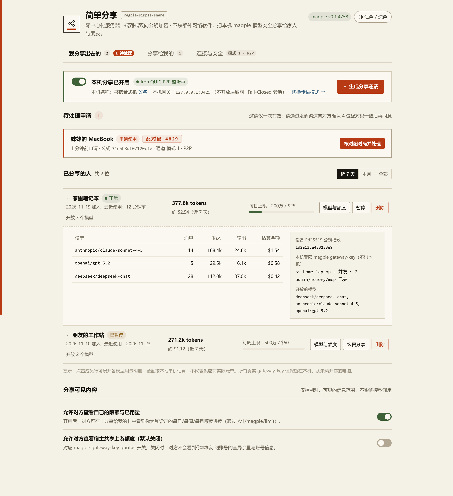
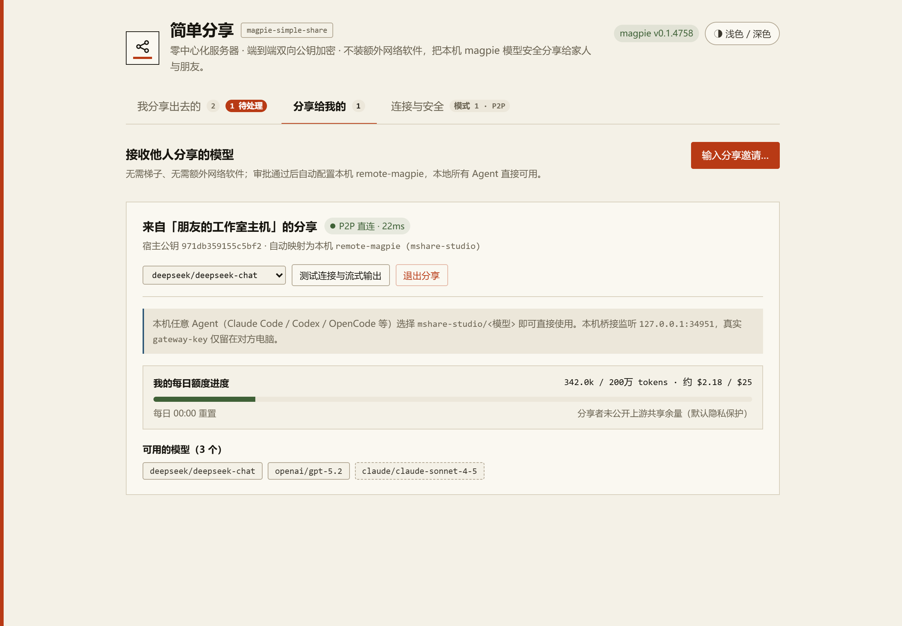
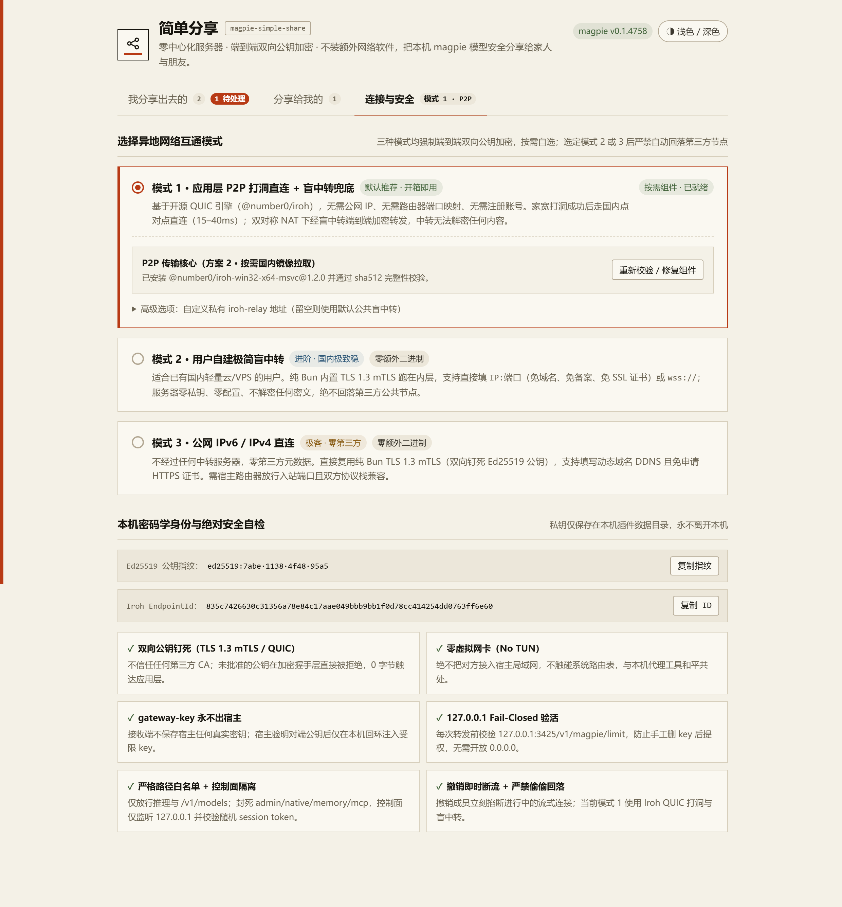

# Magpie Simple Share · 简单分享

[简体中文](README.md) · **English**

[](https://www.npmjs.com/package/@gruu6y/page-simple-share)
[](https://github.com/Gruu6y/magpie-simple-share/tags)
[](https://github.com/Gruu6y/magpie-simple-share/actions/workflows/ci.yml)
[](LICENSE)

**One sentence: a decentralized, zero-trust, out-of-the-box cross-network model sharing plugin for [magpie](https://usemagpie.ai) — share configured models and per-member quotas with family or friends over the internet without centralized accounts, third-party VPN clients, or ever letting your real keys leave your computer.**

If you only use models on one machine, or everyone shares the same LAN router, magpie's built-in LAN gateway is already enough. When you want to share your magpie providers and quotas with remote family or friends without opening a public router port, installing Tailscale/ZeroTier, or handing out your API keys or `gateway-key`, use Simple Share.



> *Screenshots show the shipped UI (currently Simplified Chinese) rendered with synthetic ledger entries, synthetic device names, and RFC 5737 documentation IPs via [scripts/shoot-readme-screenshots.mjs](scripts/shoot-readme-screenshots.mjs) — nothing from the generating machine appears in the images.*

> **Unofficial plugin notice:** Built and maintained independently by [Gruu6y](https://github.com/Gruu6y/magpie-simple-share) — **not** published by magpie or `magpie-community`. The npm package [`@gruu6y/page-simple-share`](https://www.npmjs.com/package/@gruu6y/page-simple-share) is a magpie plugin distribution package (not a standalone JS library). All code is open source — audit it, open issues, and send pull requests.

> **Important usage & platform notices:**
> - **Personal subscription Terms of Service:** Both the approval dialog and first-enable confirmation clearly distinguish **API providers / routing groups** from **personal subscription accounts**. Most consumer subscriptions restrict multi-person sharing or high concurrency — restrict sharing to small trusted family/friends usage at your own risk.
> - **Intel Mac (`darwin-x64`):** Upstream `@number0/iroh@1.2.0` publishes Apple Silicon (`darwin-arm64`) binaries only. Mode 1 (P2P) is disabled automatically on Intel Macs, and the UI guides you to **Mode 2 (self-hosted blind relay)** or **Mode 3 (direct public IPv6/IPv4)** — both require zero extra binaries.

<a id="tldr"></a>

## 30-second overview (Humans & Agents)

| Aspect | Shipped fact |
| --- | --- |
| **What it is** | Unofficial magpie page plugin (Page + loopback control-plane & bridge server) + zero-dependency CLI & HTTP API |
| **npm package / repo** | `@gruu6y/page-simple-share` · [GitHub](https://github.com/Gruu6y/magpie-simple-share) |
| **Install (humans)** | magpie → **Plugins** → **Discover** → **Unofficial** → install **Simple Share** (or `magpie plugin add` from local clone) |
| **Platforms** | **Windows x64 / arm64** · **macOS (Apple Silicon all modes verified / Intel Modes 2 & 3)** · **Linux x64 / arm64 / armv7 (auto-detects glibc & musl)** |
| **Runtime & transport** | Bun **≥ 1.4.2**; Mode 1 downloads `@number0/iroh@1.2.0` on demand (`npmmirror` → `npmjs.org` fallback) with strict `sha512` check; Modes 2 & 3 require **zero extra binaries** |
| **Core tabs** | **我分享出去的** (Shared by me) · **分享给我的** (Shared with me) · **连接与安全** (Connection & Security); zero external CDN assets, live light/dark theme sync |
| **Agent one-step entry** | Loopback service `http://127.0.0.1:3494`; run `magpie-simple-share doctor --json` or `status --json` (supports offline reads); HTTP `/api/*` requires `x-simple-share-token` |
| **Hard boundary** | **No central server, no virtual NIC (no TUN), `gateway-key` never leaves host, Fail-Closed `/v1/magpie/limit` check per request, zero prompt/response body logs** |

<a id="contents"></a>

## Contents

- [30-second overview (Humans & Agents)](#tldr)
- [What problem this solves](#what)
- [Why use it](#why)
- [Requirements and platform support](#requirements)
- [Install (magpie & npm)](#install)
- [Quick start](#quick-start)
- [Core pages](#tabs)
- [Three transport modes & blind relay deployment](#modes)
- [Core features & zero-trust security](#features)
- [Agent & command-line interface (CLI / HTTP API)](#cli)
- [Troubleshooting](#troubleshooting)
- [Privacy, data paths, and environment variables](#privacy)
- [Contributing](#contributing)
- [License](#license)

<a id="what"></a>

## What problem this solves

Sharing configured AI models from your magpie instance with remote family or friends usually forces painful workarounds:

- **Sending raw API keys or a `gateway-key`:** Once a secret leaves your computer, you lose fine-grained control; exposing magpie itself to the public internet is dangerous.
- **Third-party relays / commercial sharing platforms:** Require central vendor accounts and force traffic or credentials through third-party termination servers.
- **Mesh VPNs (Tailscale / ZeroTier):** Require installing VPN clients and TUN virtual network interfaces on both machines, often conflicting with local proxy software and placing remote devices directly onto your home LAN.

**Simple Share keeps everything in user-space inside two magpie plugins, pinned end-to-end by mutual Ed25519 public keys, while real keys never leave the host.**

| Stage | Without Simple Share | With Simple Share |
| --- | --- | --- |
| Cross-network setup | Public IP + port forwarding or VPN clients on both ends | Both sides only install this magpie plugin; Mode 1 handles P2P hole punching + blind relay fallback automatically |
| Secret isolation | Must hand out upstream API key or `gateway-key` | Real secrets stay on the host; host verifies peer Ed25519 key and injects a scoped key only over `127.0.0.1` |
| Network boundary | Virtual NIC (TUN) can expose LAN devices & clash with proxies | **Zero TUN interface**, touches zero OS routes, zero LAN exposure |
| Quotas & kill switch | Hard to cap models/tokens/concurrency or kill active streams | Dedicated restricted `magpie gateway-key` per member; pause keeps quota, **revoke aborts active SSE streams instantly** |
| Trust model | Relies on central accounts or trusted relay decryption | Zero accounts; mutual Ed25519 pinning across all modes; relays carry only opaque ciphertext bytes |

<a id="why"></a>

## Why use it

**Because magpie focuses on being your local/LAN unified model gateway — it deliberately does not bundle cross-internet P2P hole punching, out-of-band pairing approval, or zero-trust remote bridging.**

Simple Share adds that exact layer:

1. **Keyless single-use invite + 4-digit SAS verification.** Hosts generate a single-line `mshare1:...` code (5-minute TTL by default, single-use, auto-burns after 5 wrong secret attempts). After the receiver applies, both sides compare the 4-digit Short Authentication String (`HMAC-SHA256`) over chat before approval.
2. **Fail-Closed host gateway guard.** Before every forwarded inference request, the host connector verifies the member's scoped key via `GET http://127.0.0.1:<port>/v1/magpie/limit` (~1 ms). Even if a host manually deletes a `gateway-key` in magpie, requests fail closed (`403`) instead of silently escalating on loopback. Admin, native, memory, keys, and MCP routes are strictly blocked.
3. **Three transport modes with strict no-fallback.** Mode 1 (Iroh QUIC P2P + blind relay), Mode 2 (user-hosted blind forwarder over TLS 1.3 mTLS), Mode 3 (direct public IPv6/IPv4 over TLS 1.3 mTLS). Choosing Mode 2 or Mode 3 **never falls back silently** to third-party public relays.
4. **Zero manual receiver configuration.** Once approved, the receiver starts an isolated `127.0.0.1` bridge and automatically registers a `remote-magpie` provider (`mshare-<host>-<shortId>`), immediately usable by any local Agent connected to magpie.

> **Hard boundary:** Simple Share only handles encrypted cross-network forwarding and per-member quota isolation — **no free models, no upstream ToS/risk circumvention, zero telemetry**.

<a id="requirements"></a>

## Requirements and platform support

| Item | Requirement |
| --- | --- |
| **Host app** | [magpie](https://usemagpie.ai) (desktop or Linux `--tui` / CLI, with `gateway-key`, `remote-magpie`, and page plugins) |
| **Operating systems** | **Windows (x64 / arm64) · macOS (Apple Silicon / Intel) · Linux (x64 / arm64 / armv7, auto-detects glibc & musl)** |
| **Runtime** | Bun **≥ 1.4.2** |
| **Default ports** | Control plane `127.0.0.1:3494` (configurable via plugin option `port`); Mode 3 default listen port `3497`; Mode 2 blind relay default `3499` |
| **Network access** | Used only on explicit user actions: on-demand `@number0/iroh@1.2.0` download (Mode 1), cross-network pairing & encrypted forwarding, connectivity tests |

Mode 1 `@number0/iroh@1.2.0` native binary mapping (pinned `sha512` integrity verification + traversal-safe atomic extraction):

| Platform & arch | Mode 1 package (`@number0/iroh@1.2.0`) | Modes 2 & 3 (pure Bun TLS 1.3 mTLS) | Verification status |
| --- | --- | --- | --- |
| **Windows x64** (`win32-x64`) | `@number0/iroh-win32-x64-msvc` | Built-in (zero extra binaries) | **Fully verified** (`bun test` 57/57 passing, dual `magpie serve` + Chrome E2E) |
| **Windows arm64** (`win32-arm64`) | `@number0/iroh-win32-arm64-msvc` | Built-in | Mapped with pinned `sha512` integrity |
| **macOS Apple Silicon** (`darwin-arm64`) | `@number0/iroh-darwin-arm64` | Built-in | **Fully verified** (Apple Silicon macOS 26.6.2, `bun test` 57/57 passing) |
| **macOS Intel** (`darwin-x64`) | Unsupported upstream (UI guides switch cleanly) | Built-in | Modes 2 & 3 supported |
| **Linux x64 (glibc / musl)** | `@number0/iroh-linux-x64-gnu` / `-musl` | Built-in | **Fully verified** (Ubuntu 24.04.5 LTS WSL2, `bun test` 57/57 passing) |
| **Linux arm64 (glibc / musl)** | `@number0/iroh-linux-arm64-gnu` / `-musl` | Built-in | Mapped with pinned `sha512` integrity |
| **Linux armv7 (glibc / musl)** | `@number0/iroh-linux-arm-gnueabihf` / `-musl` | Built-in | Mapped with pinned `sha512` integrity |

> **macOS / Linux paths & permissions:** If `magpie` is not on your default `PATH`, Simple Share probes `~/.local/bin/magpie`, `/opt/homebrew/bin/magpie`, `/usr/local/bin/magpie`, `/Applications/magpie.app/Contents/MacOS/magpie`, and standard locations (or honors `MAGPIE_BIN`). On POSIX systems, the data directory is locked to `0700` and `identity.json` / `state.json` to `0600`.

<a id="install"></a>

## Install (magpie & npm)

### Install inside magpie (recommended)

1. Open magpie → **Plugins** → **Discover** → **Unofficial**.
2. Find **Simple Share** by **Gruu6y** and click **Install** (or run `magpie plugin add @gruu6y/page-simple-share` / `magpie plugin add <local-clone-path>`).
3. Open **Simple Share** (`简单分享`) from the left sidebar; `magpie plugin ls` should show `page  Simple Share (reads providers:list)` (`on`).

### About the npm package `@gruu6y/page-simple-share`

- Releases are published automatically from git tags `vX.Y.Z` to [`@gruu6y/page-simple-share`](https://www.npmjs.com/package/@gruu6y/page-simple-share) ([Tags](https://github.com/Gruu6y/magpie-simple-share/tags)).
- **For end users:** magpie fetches this package when installing the plugin — you do **not** need to run `npm install` manually.
- **For scripts & Agents:** The installed plugin (or source checkout) ships a zero-dependency executable CLI at [bin/simple-share.mjs](bin/simple-share.mjs) with `0755` permissions on Windows/macOS/Linux.

<a id="quick-start"></a>

## Quick start

### Host (sharing your models)

1. **Choose mode & enable sharing:** Open **Simple Share** → **我分享出去的**. If using default Mode 1 (P2P), prepare the on-demand `@number0/iroh` component under **连接与安全** (or switch straight to Mode 2 / 3 with zero downloads). Turn on the host toggle and accept the first-time privacy/ToS notice.
2. **Generate an invite:** Click **＋ 生成分享邀请** to copy a one-line `mshare1:...` code (or expand the offline SVG QR code) and send it via your preferred chat app. Invites contain zero keys, expire in 5 minutes by default, are single-use, and burn after 5 wrong guesses.
3. **Compare 4-digit SAS & approve quotas:** Once your friend applies, compare the 4-digit SAS code over chat, select allowed models (API vs personal subscription labels shown clearly), set period/token/cost/concurrency limits, and click **同意分享**.
4. **Pause, edit, or revoke anytime:** Inspect 7-day / monthly / all-time per-model usage, toggle pause (`403 share_paused`, keeps quota), or revoke (immediately aborts live SSE streams and deletes the member's `magpie gateway-key`).

### Receiver (using shared models)

1. **Paste invite:** Open **分享给我的** → **输入分享邀请…**, paste `mshare1:...`, verify the host name, mode, and Ed25519 fingerprint, enter your device name, and submit.
2. **Confirm 4-digit SAS:** Tell the host the 4-digit code shown on screen. Once approved, Simple Share automatically launches a local loopback bridge and adds a `remote-magpie` provider (`mshare-<host>-<shortId>`) ready for all local Agents.
3. **Test streaming:** Click **测试连接与流式输出** to measure live link mode, RTT, and real token streaming; leave anytime to remove the `remote-magpie` provider cleanly.

<a id="tabs"></a>

## Core pages

| Tab | Purpose |
| --- | --- |
| **我分享出去的** (Shared by me) | Host toggle & first-run notice, host name, gateway status, one-time invite & offline QR generator, pending requests with 4-digit SAS + model/quota/concurrency approval, member ledger with 7d/month/all breakdown, pause/resume/instant-abort revoke, and visibility toggles (`/v1/magpie/limit` vs `quotas`). |
| **分享给我的** (Shared with me) | Invite parser with 4 transparency guarantees, large 4-digit SAS waiting card with withdraw button, active shared provider cards (host fingerprint, live link & latency, quota bar, allowed models), and one-click streaming connectivity test / leave. |
| **连接与安全** (Connection & Security) | Switch between Modes 1, 2, and 3; on-demand `@number0/iroh` installer + custom relay URL; Mode 2 relay address/token & live reachability probe; Mode 3 direct host/port & reachability check; local Ed25519 fingerprint / EndpointId & 6 live security boundary checks. |





<a id="modes"></a>

## Three transport modes & blind relay deployment

Switch anytime in **连接与安全**. Once Mode 2 or Mode 3 is selected, **silent fallback to public third-party relays is strictly forbidden**:

| Mode | Best for | Mechanism | Extra binaries |
| --- | --- | --- | --- |
| **Mode 1 · P2P + blind relay fallback** (default) | Home broadband, CGNAT, no VPS needed | `@number0/iroh@1.2.0` QUIC hole punching + encrypted blind relay fallback (supports custom `iroh-relay` URL) | Downloaded on demand from npmmirror/npmjs with `sha512` verification |
| **Mode 2 · Self-hosted blind relay** | Any VPS / lightweight cloud server | Pure Bun TLS 1.3 mTLS end-to-end inside a minimal stateless TCP/WS forwarder (`IP:port` without domain/TLS cert, or `wss://.../ws`) | **Zero extra binaries** |
| **Mode 3 · Direct IPv6 / IPv4** | Host has reachable IPv6 or forwarded IPv4 port, zero third-party metadata | Pure Bun TLS 1.3 mTLS pinning Ed25519 keys directly (supports DDNS without CA/Let's Encrypt certs) | **Zero extra binaries** |

### Mode 2: deploying the zero-knowledge blind relay

Source lives at [relay/simple-share-relay.mjs](relay/simple-share-relay.mjs) and [relay/Dockerfile](relay/Dockerfile), and CI publishes multi-arch (`linux/amd64` / `linux/arm64`) images to `ghcr.io/gruu6y/magpie-simple-share-relay:latest`. The relay forwards opaque ciphertext by anonymous `slotId` only — **zero inner TLS termination, zero keys stored, zero member state**:

```bash
# Option A: run the multi-arch GHCR image
docker run -d --name simple-share-relay --restart=always \
  -p 3499:3499 \
  -e PORT=3499 \
  -e RELAY_TOKEN=your-strong-relay-token \
  ghcr.io/gruu6y/magpie-simple-share-relay:latest

# Option B: run directly on a VPS with Bun
PORT=3499 RELAY_TOKEN=your-strong-relay-token bun relay/simple-share-relay.mjs

# Option C: build locally from source
docker build -t simple-share-relay ./relay
```

<a id="features"></a>

## Core features & zero-trust security

- **Mutual Ed25519 public-key pinning across all modes:** A persistent Ed25519 identity generates matching self-signed mTLS certificates and an Iroh `EndpointId`. No system/public CA is ever trusted; unauthorized peers fail in the TLS/QUIC handshake with 0 application bytes delivered.
- **Blind relays cannot read traffic or metadata payloads:** Mode 2 servers bridge anonymous `slotId` byte streams while TLS 1.3 mTLS protects prompts, responses, paths, and model IDs end-to-end.
- **No silent fallback:** Mode 2 and Mode 3 failures return explicit errors and never connect to third-party public relays.
- **Strict host allowlist + 1 ms Fail-Closed `/v1/magpie/limit` guard:** Only inference endpoints (`/v1/chat/completions`, `/v1/responses`, `/v1/messages`, `/v1/messages/count_tokens`, `/v1beta/models/*:generateContent` / `:streamGenerateContent`), `/v1/models`, `/models`, `/v1/magpie/limit`, and opt-in `/v1/magpie/quotas` are forwarded. All admin, native, keys, memory, MCP, and traversal paths are blocked. Before forwarding, the host verifies the member's key over `127.0.0.1` so deleted or disabled keys fail closed instead of leaking loopback access.
- **Instant stream abort on revoke:** Revoking a member aborts all in-flight SSE requests immediately, closes their transport channel, and runs `magpie gateway-key remove` without affecting other active members.
- **Loopback control plane & sandbox-ready UI:** The control server listens only on `127.0.0.1`, validates Host/Origin, enforces per-process `x-simple-share-token`, uses zero external assets or `localStorage`, and syncs live with magpie's light/dark theme inside `iframe sandbox="allow-scripts"`.

<a id="cli"></a>

## Agent & command-line interface (CLI / HTTP API)

Simple Share ships a zero-dependency CLI ([bin/simple-share.mjs](bin/simple-share.mjs)) and local loopback HTTP API (`http://127.0.0.1:3494`):

1. Run `bun bin/simple-share.mjs doctor --json` or `status --json` (read-only commands `doctor`, `status`, `members`, `pending`, `received`, and `mode` also work offline directly from sanitized local state).
2. Mutating commands require the local loopback service and automatically read the per-process `x-simple-share-token` from `<meta name="simple-share-token">` at `/`.
3. `--json` writes clean JSON to stdout (exit `0`) or single-line JSON `{"error","code","message"}` to stderr (exit `1`), never leaking tokens or secrets.

| Category | Command | Description |
| --- | --- | --- |
| **Diagnostics** | `doctor [--json]` / `status [--json]` | Full diagnostics (identity, gateway, `iroh`, security checks) / sanitized state snapshot |
| **Host invites** | `toggle <on\|off> [--tos]` / `invite` / `invite revoke <id>` | Toggle sharing (`--tos` required on first enable), create or revoke `mshare1:` invite |
| **Approvals & members** | `pending` / `approve <id> [...]` / `reject <id>` / `members` / `pause <id>` / `resume <id>` / `revoke <id>` | Manage applications, scoped quotas/concurrency/models, pause/resume, or instant-abort revoke |
| **Receiver** | `apply <mshare1:...> [--name <name>]` / `received` / `received test <id>` / `received leave <id>` | Apply with invite (prints 4-digit SAS), inspect shares, run E2E streaming probe, or leave |
| **Transport** | `mode [p2p\|self-relay\|direct]` | View or configure active transport mode (`--iroh-relay`, `--relay`, `--relay-token`, `--host`, `--direct-port`) |

Run `bun bin/simple-share.mjs --help` for full flags and HTTP route details.

<a id="troubleshooting"></a>

## Troubleshooting

| Symptom | Fix |
| --- | --- |
| `tos_required` on first `toggle on` | Acknowledge the privacy & upstream-ToS prompt in the UI or pass `--tos` to `toggle on`. |
| Invite rejected or expired | `mshare1:...` codes expire after **5 minutes**, are **single-use**, and auto-burn after **5 wrong attempts**; generate a fresh invite on the host. |
| Intel Mac reports Mode 1 unsupported | `@number0/iroh@1.2.0` has no `darwin-x64` package; switch to Mode 2 (blind relay) or Mode 3 (direct TLS 1.3 mTLS). |
| Mode 2 / 3 does not fall back to P2P | Intentional zero-trust rule: check VPS firewall/port forwarding, `RELAY_TOKEN`, and use the built-in connectivity test buttons. |
| `403 share_paused` | Host paused the member (quotas preserved); ask the host to click resume. |
| `magpie` binary not found | Run `bun bin/simple-share.mjs doctor --json` and set `MAGPIE_BIN=/path/to/magpie` if installed outside standard paths. |

<a id="privacy"></a>

## Privacy, data paths, and environment variables

- **Zero telemetry, zero prompt/response storage:** Usage tracking aggregates token counts and local cost estimates only. All API & CLI snapshots pass through `sanitizeStateSnapshot` so private keys, invite secrets, `bridgeToken`, and `magpieKeySecret` are never exposed.
- **Data directory:** `~/.config/magpie/magpie-simple-share/` (overridable via `MAGPIE_CONFIG_DIR` / `XDG_CONFIG_HOME` / `MAGPIE_SIMPLE_SHARE_DATA`): `identity.json` (`0600`), `state.json` (`0600`), and `iroh/`.
- **Environment variables:**
  - `MAGPIE_CONFIG_DIR`: Overrides Magpie config root.
  - `MAGPIE_SIMPLE_SHARE_DATA` / `MAGPIE_SIMPLE_SHARE_DATA_DIR`: Overrides Simple Share data directory.
  - `SIMPLE_SHARE_PORT`: Overrides default control-plane port (`3494`).
  - `MAGPIE_BIN` / `SIMPLE_SHARE_MAGPIE_BIN` / `MAGPIE_CLI`: Explicit `magpie` binary path (boolean values such as `MAGPIE_CLI=1` are ignored automatically).
  - `MAGPIE_ADDR`: Overrides loopback gateway URL.
  - `HOST` / `PORT` / `RELAY_TOKEN`: Configures [relay/simple-share-relay.mjs](relay/simple-share-relay.mjs) (`0.0.0.0`, `3499`, optional auth token).

<a id="contributing"></a>

## Contributing

Security audits, bug reports, and pull requests are welcome:

```bash
bun test
```

Without a local `magpie` binary or headless browser, external-binary E2E suites skip cleanly while all core cryptography, framing, gateway-isolation, Fail-Closed, transport, and blind-relay tests run. Set `REQUIRE_MAGPIE_E2E=1 REQUIRE_BROWSER_TESTS=1` where both are installed to enforce all 57 tests across all 8 test files. Use [scripts/shoot-readme-screenshots.mjs](scripts/shoot-readme-screenshots.mjs) to regenerate sanitized screenshots. Architecture and security design notes are in [docs/architecture.md](docs/architecture.md).

<a id="license"></a>

## License

[MIT](LICENSE) © 2026 Gruu6y · Architecture & security design in [docs/architecture.md](docs/architecture.md)
